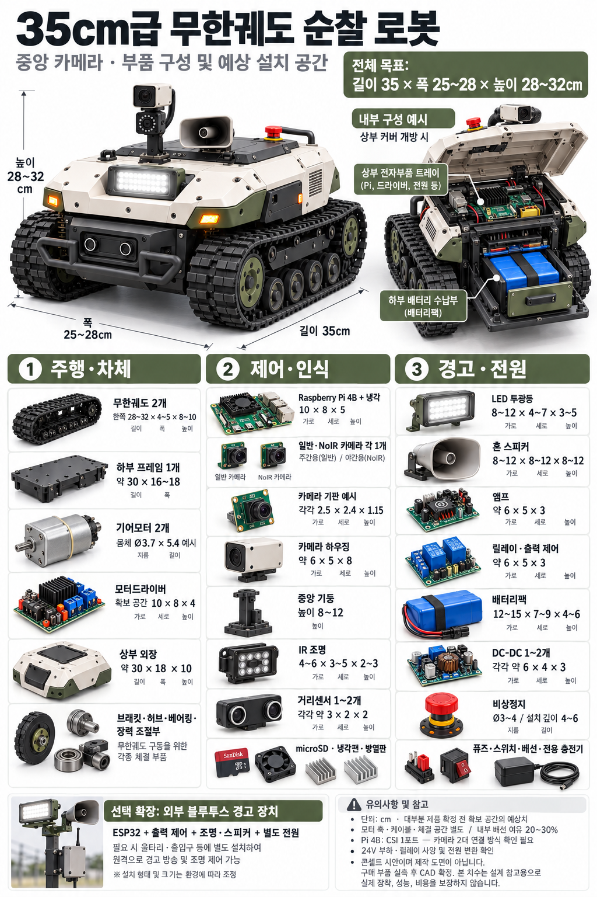
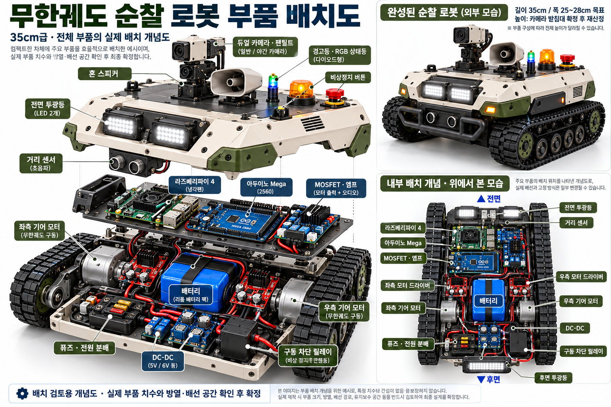

# 농경지 순찰 로봇 (팀 탱크걸 캡스톤디자인)

농경지의 관찰 지점을 순회하며 야생동물(대표 시나리오: 고라니)을 발견하고, 음향·LED 자극으로 대응한 뒤
재관찰 결과를 관리자에게 기록·제공하는 자율주행 로봇입니다.
기존 aicar(Raspberry Pi + OpenCV + Nvidia CNN 조향각 예측)의 카메라 기반 주행 기능을 그대로 유지하고, 그 위에 순찰 서비스 기능을 더합니다.

<p align="center">
  
</p>
<p align="center"><sub>외형·부품 구성 콘셉트 (제작 도면 아님, 실측 후 CAD 확정)</sub></p>

<p align="center">
  
</p>
<p align="center"><sub>내부 부품 배치 개념도 (실제 부품 치수·방열·배선 공간 확인 후 확정)</sub></p>

## 동작 개요

```
주행      카메라 → 영상 전처리 → CNN 조향각 예측 → 좌우 모터 속도 제어 → 모터드라이버 → 바퀴
장애물    VL53L0X → 전방 장애물 판단 → 주행 정지
서비스    관찰 영상·구역 번호 → 동물/사람 탐지 → 작동 허용 판단 → 음향·LED 출력
          → 재관찰 → 결과 판정(잔류 / 이탈 / 관찰 불가) → 저장 · Wi-Fi 원격 조회
```

안전 원칙
- 사람이 탐지되거나 분류가 불확실하면 자극을 작동하지 않고 기록·알림만 남깁니다.
- 수동 정지와 장애물 정지가 서비스 동작보다 항상 우선합니다.
- 대상이 화면에서 사라졌다는 이유만으로 퇴치 성공으로 기록하지 않습니다.

## 사용 기술 및 부품

### 하드웨어

| 구분 | 사용 부품 | 비고 |
|------|-----------|------|
| 메인 컴퓨터 | Raspberry Pi 4B 4GB, microSD 32GB 이상 | 공통 필수 |
| 카메라 | 기존 aicar 카메라 | 야간 기능은 기존 카메라의 적외선 감도 확인 후 NoIR 카메라 + IR 조명 적용 여부 결정 |
| 거리센서 | VL53L0X ToF (I²C) | 전방 장애물 감지 전용 (동물 거리 측정용 아님) |
| 구동부 | 모터 + 모터드라이버 (기존 aicar: DC 모터 2개 + TB6612FNG) | Pi GPIO 에서 좌우 모터를 직접 PWM 제어. 구동부 부품은 조사 후 선정 |
| 기피 출력 | 소형 스피커 + 구동용 증폭 회로, LED | 기피용 가시광 LED 와 야간 IR 조명은 목적이 다른 장치로 구분 |
| 기존 입출력 | 부저, 네오픽셀 전조등, 방향지시·브레이크 램프, CdS 조도센서 | 원본 aicar 구성 |
| 전원 | 배터리 및 전원부 | 모터·출력장치 최대 소비전류 검토 후 선정 |
| 차체 | 3D 프린팅 차체 및 케이스 (CAD → STL) | 무게중심·카메라 시야·발열·정비 접근성 고려 |
| 디스플레이 | 사용 안 함 | Wi-Fi 원격 접속으로 운용 |

### 소프트웨어

| 영역 | 사용 기술 | 기반 코드 | 상태 |
|------|-----------|-----------|------|
| 주행 이미지 수집 | 수동 주행(키보드·마우스) 중 200x66 YUV 이미지 + 조향각 파일명 저장 | `gi.py` | 원본 |
| 데이터 편집·학습 | 조향각 7구간 분류, 훈련/평가/시험 분리, 증강, Pi 단독 학습 또는 ZIP 생성 | `dl.py` | 원본 |
| 모델 학습 (GPU) | PyTorch Nvidia CNN 조향각 회귀, Google Colab T4 | `aicarA.ipynb` | 원본 |
| 자율주행 | CNN 조향각 → 좌우 모터 PWM (`RUN_SPEED ± angle`), VL53L0X 경적·정지, 신호등 인식 | `ar.py` | 원본 |
| 동물·사람 탐지 | OpenCV DNN + SSD (COCO 91종: 사람·새·고양이·개·말·양·소·곰 등) | `od.py` | 원본 — 고라니·사슴 클래스 없음 → 모델 교체/추가 학습 검토 |
| 구역 인식 | 시각 표식으로 관찰 지점 번호 확인 (GNSS·자유 경로 탐색 제외) | | 예정 |
| 서비스 로직 | 상태 기반 동작 (순찰 → 관찰 → 자극 → 재관찰 → 기록 → 복귀), 최근 자극 이력을 고려한 규칙 기반 자극 선택 | | 예정 |
| 기록·조회 | 이벤트 기록(시각·구역·탐지 종류·신뢰도·자극·판정·사진) + Wi-Fi 로컬 조회 화면 | | 예정 — 외부 서비스 비의존 |

## 진행 현황

| 기능 | 상태 |
|------|------|
| 주행 이미지 수집 / 데이터 편집 / 학습 / 자율주행 | ✅ 원본 aicar 코드 확보 (실차 미검증) |
| 전방 장애물 정지 (VL53L0X) | ✅ 원본 `ar.py` 에 포함 — 정지 거리 조정 필요 (현재 110mm, 목표 초기값 200mm) |
| 동물 · 사람 탐지 | 🔶 `od.py` 기반 COCO 탐지 — 목표 동물 대응 필요 |
| 관찰 지점 정차 · 구역 인식 | ⬜ 예정 |
| 음향 · LED 기피 자극 제어 | ⬜ 예정 |
| 재관찰 결과 판정 | ⬜ 예정 |
| 기록 저장 · Wi-Fi 원격 조회 화면 | ⬜ 예정 |

## 정량 목표 (초기 설계값, 예비시험 후 조정)

| 항목 | 목표 |
|------|------|
| 자율주행 성공률 | 모사 코스 20회 중 충돌·이탈·수동 개입 없이 90% 이상 |
| 장애물 대응 | 전방 20cm 정지 (속도별 제동거리 시험으로 조정) |
| 목표 동물 탐지 | 분리된 평가 데이터에서 재현율 85% 이상 (정밀도·주야간 함께 보고) |
| 사람 동반 시 대응 | 사람 단독·동시 등장 시험에서 자극 작동 0회 |
| 결과 판정 | 잔류·이탈·가림 시나리오 각 10회, 정확도 90% 이상 |
| 연속 동작 | 주행·탐지·간헐적 자극 포함 20분 이상 |

## 폴더 구조

```
aicar/              원본 aicar 코드 (수정하지 않고 사용)
  gi.py             주행 이미지 수집
  dl.py             이미지 편집 · 데이터 분리 · 학습(Pi 단독) · Colab 용 ZIP 생성
  aicarA.ipynb      Colab GPU 학습 노트북
  ar.py             자율주행
  od.py             객체(동물·사람) 탐지
assets/images/      README·문서용 이미지
docs/               캡스톤 문서 (git 제외)
```

`aicar/` 의 원본 파일은 `.gitattributes` 로 줄바꿈 변환 없이 그대로 보관합니다.

## 사용 방법 (Raspberry Pi, `aicar/` 폴더에서 실행)

모든 프로그램은 `./_IMAGE/`, `./<프로젝트>/` 같은 상대 경로를 쓰므로 반드시 `aicar/` 폴더 안에서 실행합니다.

```bash
cd aicar

# 1. 주행 이미지 수집 - wayA/ 폴더에 P0001__+12.png 형식으로 저장
python3 gi.py wayA

# 2. 데이터 편집 후 학습
python3 dl.py wayA
#    [Z] → wayA.zip 생성 (Colab 학습용)   [P] → Raspberry Pi 에서 바로 학습

# 3. (Colab 학습 시) aicarA.ipynb 에 wayA.zip 업로드 → T4 GPU → 모두 실행
#    → _wayA_model_check.pt 를 Pi 의 ~/Downloads 또는 aicar/wayA/ 에 복사

# 4. 자율주행 - [G] 시작, [D] 거리센서, [Space] 정지, [X] 종료
python3 ar.py wayA

# 5. 객체 탐지
python3 od.py
```

## 저장소에 아직 없는 원본 파일

원본 코드가 import 하거나 읽는 파일입니다. aicar 키트/수업 자료에서 받아 `aicar/` 에 넣어야 실행됩니다.

| 파일 | 사용하는 코드 | 용도 |
|------|---------------|------|
| `VL53L0X.py` (+ 관련 라이브러리) | `ar.py` | ToF 거리센서 |
| `ts.py` | `ar.py` | 신호등 인식 |
| `NEOPIXEL.py` | `ar.py`, `gi.py` | 네오픽셀 전조등 |
| `_IMAGE/armL.png`, `armR.png`, `gimL.png`, `gimR.png`, `controlBox.png`, `dashBoard.png` | `ar.py`, `gi.py`, `dl.py` | 화면 UI 이미지 |
| `od_ssd.pbtxt`, `od_graph.pb`, `od_coco.names` | `od.py` | SSD 탐지 모델·클래스 이름 |

## 원본 코드 GPIO 배선 (BCM 번호)

| 신호 | 핀 | | 신호 | 핀 |
|------|----|-|------|----|
| 왼쪽 모터 PWM | 12 | | 경적(부저) | 23 |
| 왼쪽 모터 방향 | 5 | | 후진 사운드 | 24 |
| 오른쪽 모터 PWM | 13 | | 우측 방향지시등 | 20 |
| 오른쪽 모터 방향 | 6 | | 좌측 방향지시등 | 26 |
| CdS 조도센서 | 25 | | 브레이크 램프 | 21 |

VL53L0X 는 I²C, 네오픽셀은 `NEOPIXEL.py` 설정을 따릅니다.

## 확인이 필요한 항목

- [ ] 위 "저장소에 아직 없는 원본 파일" 확보
- [ ] Raspberry Pi 에 필요한 패키지: OpenCV, NumPy, PyTorch, scikit-learn, RPi.GPIO, 네오픽셀·VL53L0X 라이브러리
- [ ] `gi.py` 종료 시 `sudo chown pi:pi` 를 실행하므로 Pi 사용자 이름이 `pi` 가 아니면 확인 필요
- [ ] LCD 를 쓰지 않으므로 전체화면 OpenCV 창은 VNC 원격 화면에서 확인
