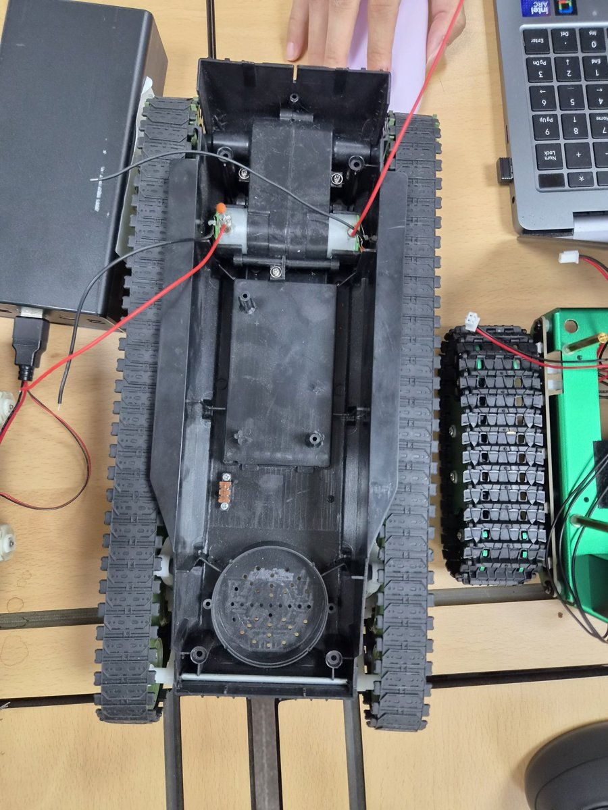

# DC 모터 (주행)

차량 주행에 쓰는 DC 모터 정리입니다. 코드는 `aicar/gi.py`, `aicar/gi_servo.py`의 `motorRun()`을 기준으로 합니다.

## 1. 구성

<p align="center"></p>

| 항목 | 내용 |
|------|------|
| 차체 | 무한궤도(탱크형) 차체. 좌·우 궤도를 각각 모터 1개가 구동 |
| 모터 | 은색 원통형 브러시 DC 모터 2개. 차체 한쪽 끝 가운데 기어박스의 양옆에 하나씩 끼워져 좌·우 궤도 구동 |
| 배선 | 모터 단자에 빨강·검정 선 납땜, 수축 튜브로 연장해 모터 드라이버 `A1·A2`, `B1·B2` 로 |
| 극성 표시 | 모터 단자 한쪽의 주황·빨간 점 = + 쪽 (방향이 반대면 그 모터의 두 선을 바꿔 끼움) |
| 모터 드라이버 | TB6612 보드 → [DC_moter_driver.md](DC_moter_driver.md) |
| 제어 | Raspberry Pi 4 GPIO: 좌·우 PWM(속도) 1개씩 + 방향 1개씩 |
| PWM 주파수 | 500Hz (`RPi.GPIO` 소프트웨어 PWM) |

## 2. 핀

| 용도 | 코드 이름 | GPIO(BCM) | 물리 핀 | 확장보드 글씨 |
|------|-----------|-----------|---------|---------------|
| 왼쪽 모터 속도(PWM) | `MOTOR_L_PWM` | GPIO12 | 32번 | P12 |
| 왼쪽 모터 방향 | `MOTOR_L_DIR` | GPIO5 | 29번 | P5 |
| 오른쪽 모터 속도(PWM) | `MOTOR_R_PWM` | GPIO13 | 33번 | P13 |
| 오른쪽 모터 방향 | `MOTOR_R_DIR` | GPIO6 | 31번 | P6 |
| (참고) CdS 빛 센서 | `LIGHT_SENSOR` | GPIO25 | 22번 | P25 |

> **서보모터를 32·33번 핀에 꽂지 마세요.**
> 32·33번(GPIO12·13)은 DC 모터 속도 신호 핀이라, 서보가 꽂혀 있으면 `gi.py`를 실행할 때 서보가 엉뚱하게 움직이고 버팁니다.
> 서보는 11·13번(GPIO17·27)에 꽂습니다 ([Servo_moter.md](Servo_moter.md) 1절). 그러면 `gi_servo.py`에서 DC 모터와 서보가 함께 동작합니다.
> 2026-10-29 이전 `gi_servo.py`는 서보를 GPIO12·13 에 두고 DC 모터를 껐습니다. 터미널에
> `[모터] 왼쪽 모터 PWM(P12) 은 서보모터가 사용하므로 끕니다` 가 나오면 라즈베리파이의 파일이 옛 버전입니다.

## 3. 동작 원리 (`motorRun(leftMotor, rightMotor)`)

- 입력 범위: 좌·우 각각 **-100 ~ +100**
- **부호 = 방향**: `+` 전진, `-` 후진 → 방향 핀(`MOTOR_x_DIR`)을 HIGH / LOW 로 설정
- **절댓값 = 속도**: PWM 듀티비 0(정지) ~ 100(최고 속도)
- 100 을 넘는 값은 100 으로 자릅니다.

| 동작 | 왼쪽 | 오른쪽 |
|------|------|--------|
| 전진 | +80 | +80 |
| 후진 | -70 | -70 |
| 제자리 좌회전 | -70 | +70 |
| 제자리 우회전 | +70 | -70 |
| 정지 | 0 | 0 |

마우스 주행 중에는 조향 각도로 좌우 속도를 나눕니다.

```
s  = 조향각 × defMotorAngle(0.15)
왼쪽 = 기준 속도 + s
오른쪽 = 기준 속도 - s
```

## 4. 조작 키 (카메라 화면 창 `Out` 을 클릭한 뒤)

| 키 | 동작 |
|----|------|
| ↑ | 전진 (한 번 더 누르면 정지) |
| ↓ | 후진 (한 번 더 누르면 정지) |
| ← | 제자리 좌회전 (한 번 더 누르면 정지) |
| → | 제자리 우회전 (한 번 더 누르면 정지) |
| Space | 정지 |
| 마우스 왼쪽 버튼 | 주행 시작 → 한 번 더 누르면 녹화(이미지 수집) |
| 마우스 오른쪽 버튼 | 주행·녹화 취소, 정지 |
| ESC / TAB / X | 프로그램 종료 |

## 5. 속도 관련 설정값 (`gi.py`, `gi_servo.py` 위쪽)

| 이름 | 기본값 | 뜻 |
|------|--------|-----|
| `defForSpeed` | 60 | 이미지 수집 주행의 기본 전진 속도 (PWM) |
| `defMotorAngle` | 0.15 | 조향각을 좌우 속도 차이로 바꾸는 비율 |
| `REC_LOW_FORWARD_SPEED` | 40 | 가변 속도 모드에서 녹화 중 최저 속도 |

## 6. 문제 해결

| 증상 | 확인 |
|------|------|
| 한쪽 바퀴만 안 돎 | 라즈베리파이의 `gi_servo.py`가 옛 버전인지(위 주의), 드라이버 배선 |
| 전진인데 뒤로 감 | 그 모터의 +·- 선을 바꾸거나 방향 핀 배선 확인 |
| 출발하다 Pi 가 재부팅·`[전원 경고]` | 모터 전원을 Pi 와 분리(배터리 → 드라이버), GND 공통 |
