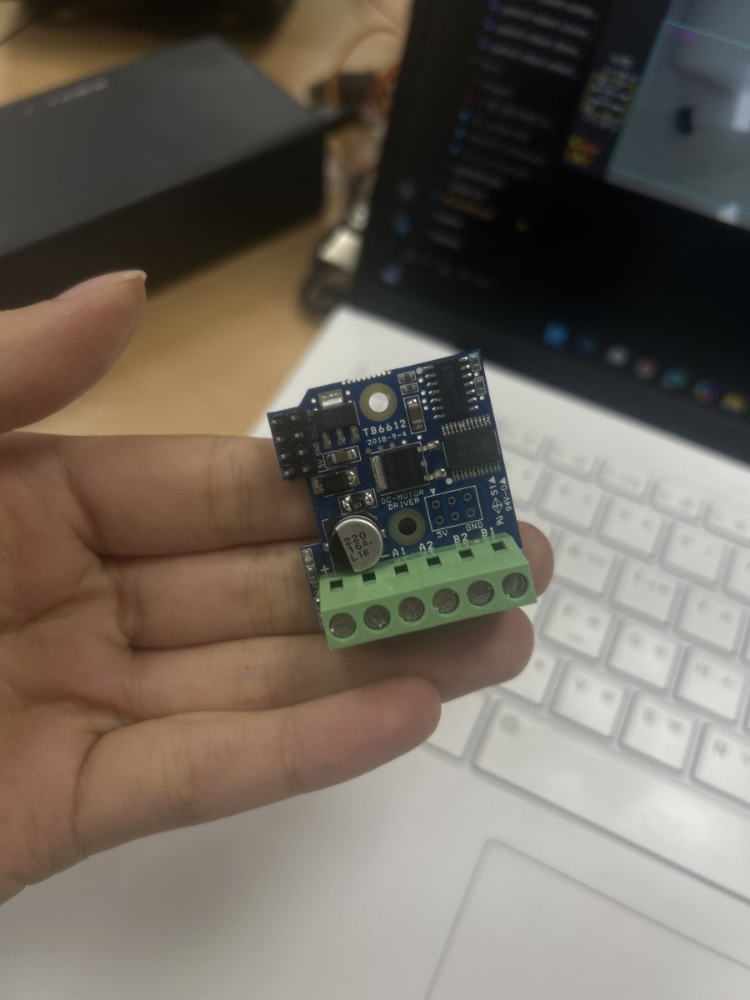

# DC 모터 드라이버 (TB6612)

좌·우 DC 모터를 구동하는 모터 드라이버 보드 정리입니다. 모터와 주행 코드는 [DC_moter.md](DC_moter.md).

> 이 문서의 내용은 **보드 사진과 `gi.py` 코드에서 확인한 것**과 **추정**을 구분해 적었습니다.
> 추정 항목은 멀티미터나 판매처 자료로 확인한 뒤 고쳐 주세요.

## 1. 보드 정보 (사진에서 확인)

| 항목 | 내용 |
|------|------|
| 보드 인쇄 | `TB6612`, `2018-9-4`, `DC-MOTOR DRIVER` |
| 드라이버 칩 | Toshiba **TB6612FNG** (칩 인쇄 `6612FNG`) |
| 채널 | 2채널: A(A1·A2), B(B1·B2) → 왼쪽·오른쪽 모터 각 1개 |
| 부품 | 220µF 16V 전해 커패시터, SS14 쇼트키 다이오드, 레귤레이터(SOT-223), 14핀 로직 IC |
| 나사 단자 (아래 초록색, 6핀) | `+`, `−`, `A1`, `A2`, `B2`, `B1` |
| 핀 헤더 (왼쪽, 2×4) | 오른쪽 열 글씨: 위에서부터 `VIO`, `GND`, `GND`, `5V`. 왼쪽 열은 글씨 없음 |
| 빈 납땜 자리 (2×3) | `5V`, `GND`, `S1` 표시 (부품 없음) |

## 2. TB6612FNG 칩 사양 (데이터시트)

| 항목 | 값 |
|------|-----|
| 모터 전원(VM) | 2.5 ~ 13.5V (절대 최대 15V) |
| 로직 전원(VCC) | 2.7 ~ 5.5V → Raspberry Pi 3.3V 신호로 제어 가능 |
| 출력 전류 | 채널당 연속 1.2A, 순간 최대 3.2A |
| PWM 주파수 | 최대 100kHz (코드는 500Hz 사용) |
| 보호 | 과열 차단, 저전압 차단 |

보드의 커패시터가 16V 용이므로 **모터 전원은 12V 이하**로 씁니다.

## 3. 배선

### 나사 단자 (모터·모터 전원)

| 단자 | 연결 | 비고 |
|------|------|------|
| `+` | 모터 전원 + (배터리) | 추정: TB6612 VM. 위치상 `+` 옆 단자가 `−` |
| `−` | 모터 전원 − (GND) | Raspberry Pi GND 와 공통이어야 신호가 맞음 |
| `A1`, `A2` | 왼쪽 모터 두 선 | 코드상 A 채널 = 왼쪽인지는 배선으로 확인 |
| `B1`, `B2` | 오른쪽 모터 두 선 | |

모터가 반대로 돌면 그 모터의 두 선(A1↔A2 또는 B1↔B2)을 바꿔 끼우면 됩니다.

### 핀 헤더 (Raspberry Pi 와 연결)

코드(`gi.py`)가 쓰는 신호는 모터마다 **속도(PWM) 1개 + 방향 1개**입니다.

| 신호 | Raspberry Pi | 물리 핀 |
|------|--------------|---------|
| 왼쪽 속도 PWM | GPIO12 | 32번 |
| 왼쪽 방향 | GPIO5 | 29번 |
| 오른쪽 속도 PWM | GPIO13 | 33번 |
| 오른쪽 방향 | GPIO6 | 31번 |
| GND | GND | 예: 30·34번 |
| VIO | 3.3V (추정: 로직 전압) | 1·17번 |

> **추정**: TB6612 칩은 모터마다 IN1·IN2·PWM 3개 신호가 필요한데 코드는 방향 1개만 씁니다.
> 보드의 14핀 로직 IC 가 방향 신호 1개를 뒤집어 IN1·IN2 두 개로 만드는 것으로 보입니다 (STBY 는 보드에서 HIGH 로 고정된 것으로 추정).
> 헤더 왼쪽 열(글씨 없음) 4핀이 위 4개 신호이고, 어느 핀이 어느 신호인지는 기존 배선 또는 판매처 핀맵으로 확인해야 합니다.

## 4. 동작 (코드 기준)

| 방향 핀 | PWM 듀티 | 모터 |
|---------|----------|------|
| HIGH | 0 ~ 100 | 전진, 숫자가 클수록 빠름 |
| LOW | 0 ~ 100 | 후진 |
| 상관없음 | 0 | 정지 |

`motorRun(left, right)` 에 -100 ~ +100 을 넣으면 부호로 방향 핀을, 절댓값으로 PWM 을 정합니다. 자세한 건 [DC_moter.md](DC_moter.md) 3절.

## 5. 주의

- **서보모터를 GPIO12·13(32·33번)에 꽂지 않습니다.** 모터 속도 신호 핀입니다. 서보는 11·13번 핀 ([Servo_moter.md](Servo_moter.md)).
- 모터 전원과 Raspberry Pi 전원은 따로 쓰고 **GND 만 공통**으로 묶습니다. 모터를 Pi 5V 에서 돌리면 Pi 가 재부팅됩니다.
- 모터가 오래 막혀 있으면(벽에 밀리는 등) 칩이 뜨거워지고 과열 차단으로 멈춥니다. 식으면 다시 동작합니다.
- 배선을 바꿀 때는 모터 전원(배터리)을 먼저 끕니다.
