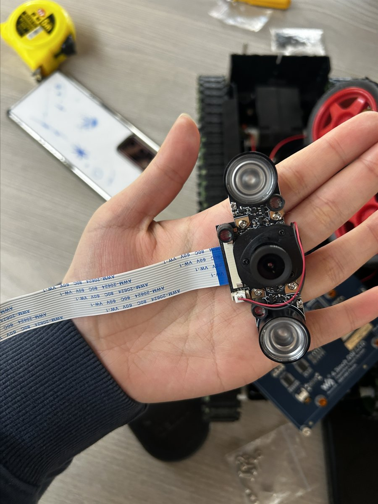

# 적외선 카메라 (OV5647 IR-CUT)

> **2026-11-06 현재 환경:** 아래 2026-11-05 Legacy 방식 확인 기록과 달리, 이번 Pi에서는 `start_x=1` 상태에서 카메라가 감지되지 않았습니다. `#start_x=1`, `camera_auto_detect=0`, `dtoverlay=ov5647`로 변경한 뒤 libcamera 인식·촬영에 성공했고 `gi.py`는 Picamera2로 변경했습니다. 재현 명령과 실제 로그는 [카메라 인식 이슈](issues/2026-11-06-ov5647-camera.md)를 기준으로 확인하세요. 아래 과거 코드·설정 설명이 현재 `gi.py`에도 그대로 적용되는 것은 아닙니다.

주야간 자동 전환 적외선 카메라 모듈을 Raspberry Pi 4 에 연결해 주행·탐지 영상으로 쓰는 방법입니다.
코드: `aicar/gi.py`, `aicar/gi_servo.py`, `aicar/ar.py`, `aicar/od.py` (카메라 여는 부분만 관련)

<p align="center"></p>

> 이 문서는 **판매처 상품 설명**과 **코드에서 확인한 것**을 바탕으로 썼습니다.
> Pi 에서 실제로 확인하지 않은 항목은 **(미확인)** 으로 표시했습니다. 확인한 뒤 고쳐 주세요.

## 1. 제품 정보 (판매처 상품 설명)

| 항목 | 내용 |
|------|------|
| 제품 | 라즈베리파이 적외선 카메라 모듈 – 5MP OV5647 – IR-CUT 주야간 자동전환 – 라이트 2개 |
| 이미지 센서 | OV5647 (5MP), 1/4인치 |
| 렌즈 | 3MP 렌즈, 회전식 초점 조절 |
| 조리개 / 초점거리 | F1.8 / 3.6mm |
| 화각 | 약 75.7° |
| 권장 해상도 | 1080p (렌즈가 3MP 사양이라 1080p 가 최적) |
| 필터 전환 | IR-CUT 필터 내장, 기판 조도 센서로 주간/야간 자동 전환 |
| IR 라이트 | 2개, 고정 나사 구멍을 통해 카메라 기판에서 전원 공급 (별도 배선 없음) |
| 연결 | CSI 카메라 단자, 15핀 FFC 케이블 (약 15.5cm) |
| 크기 | 카메라 기판 약 31 × 32mm, **라이트 장착 시 약 80 × 30mm** |
| 장착 | 고정용 나사 구멍 4개 |
| 호환 | Raspberry Pi 4 / 3B+ / 3 / 2 / 1 / B+ / A+. Zero 불가, Pi 5 는 변환 케이블 필요 |
| 구성품 | IR-CUT 카메라 1, 적외선 라이트 보드 2, 15핀 FFC 케이블 1 |

## 2. 코드로 제어할 것이 없는 부분

| 기능 | 동작 방식 | 코드 |
|------|-----------|------|
| IR-CUT 필터 전환 | 기판 조도 센서가 하드웨어로 전환 | 없음 (GPIO 제어선이 없어 코드로 켜고 끌 수 없음) |
| IR 라이트 | 카메라 기판 전원으로 동작, 어두우면 켜짐 | 없음 |
| 초점 | 렌즈를 손으로 돌려 맞춤 | 없음 |

즉 이 카메라 때문에 새 제어 코드를 짤 필요는 없습니다. 바뀔 수 있는 것은 **카메라를 여는 방식**뿐입니다(4절).

## 3. 연결과 설정

1. **전원을 끈 상태에서** 15핀 케이블을 Pi 의 CSI 카메라 단자(HDMI 포트 옆 `CAMERA`)에 꽂습니다.
   케이블의 금속 접점 방향을 확인합니다. Pi 4 는 접점이 HDMI 포트 쪽을 향합니다.
2. IR 라이트 보드 2개를 카메라 양옆 나사 구멍에 나사로 고정합니다. 나사가 전원 통로이므로 단단히 조입니다.
3. (libcamera 스택을 쓸 때만) 자동 인식이 안 되면 `/boot/config.txt` (Bookworm 은 `/boot/firmware/config.txt`) 를 고치고 재부팅합니다.
   ```
   camera_auto_detect=0
   dtoverlay=ov5647
   ```
4. 인식 확인:
   ```bash
   libcamera-hello --list-cameras     # Bookworm 은 rpicam-hello --list-cameras
   libcamera-hello -t 5000            # 5초 미리보기 (화면 필요: VNC 또는 Pi 모니터)
   ```
5. 미리보기를 보며 렌즈를 천천히 돌려 초점을 맞춥니다. 주행용이면 차 앞 지면(약 20 ~ 50cm)에 맞춥니다.

## 4. 지금 코드에서 카메라가 열리는지 (미확인)

주행·탐지 코드 네 곳이 모두 OpenCV V4L2 방식으로 `/dev/video0` 을 엽니다.

| 파일 | 위치 | 코드 |
|------|------|------|
| `aicar/gi.py` | 262줄 | `cam = cv.VideoCapture(0,cv.CAP_V4L)` |
| `aicar/gi_servo.py` | 278줄 | `cam = cv.VideoCapture(0,cv.CAP_V4L)` |
| `aicar/ar.py` | 245줄 | `camera=cv.VideoCapture(0,cv.CAP_V4L)` |
| `aicar/od.py` | 20줄 | `cap = cv2.VideoCapture(0,cv2.CAP_V4L)` |

이 방식이 되는지는 Pi OS 의 카메라 스택에 달려 있습니다.

| Pi OS | `VideoCapture(0)` | 할 일 |
|-------|-------------------|-------|
| Buster, 또는 Bullseye 에서 Legacy Camera 켬 | 됨 | 코드 수정 없음. `raspi-config` 에서 카메라만 켬 |
| Bullseye 기본, Bookworm (libcamera) | 프레임을 못 읽을 가능성이 큼 | ① `libcamerify python3 gi.py` 로 실행 (코드 수정 없음) ② 안 되면 네 파일을 `Picamera2` 로 수정 |

판매처 설정 안내(`dtoverlay=ov5647`)는 libcamera 스택 기준입니다.

### 우리 Pi 확인 결과 (2026-11-05)

| 명령 | 결과 |
|------|------|
| `/etc/os-release` | Debian 11 (bullseye) |
| `libcamera-hello --list-cameras` | `No cameras available!` |
| `VideoCapture(0,CAP_V4L).read()` | `True` |

| `vcgencmd get_camera` | `supported=1 detected=1, libcamera interfaces=0` |
| `v4l2-ctl --list-devices` | `/dev/video0` = `mmal service 16.1 (platform:bcm2835_v4l2-0)` |
| `/boot/config.txt` | `start_x=1`, `camera_auto_detect`·`dtoverlay=ov5647` 없음 |

**결론: Legacy Camera 스택으로 CSI 카메라가 `/dev/video0` 에 잡혀 있고, 지금 코드 그대로 동작합니다. 코드 수정 없음.**
libcamera 가 `No cameras available!` 를 내는 것은 Legacy 스택에서는 정상입니다.

- **판매처 안내대로 `camera_auto_detect=0`, `dtoverlay=ov5647` 을 넣지 않습니다.** libcamera 스택으로 바뀌어 지금 코드가 프레임을 못 읽게 됩니다.
- 카메라 확인은 `libcamera-hello` 대신 `raspistill -o test.jpg` 또는 주행 프로그램 화면으로 합니다.
- 기존 Pi 카메라 v1 도 같은 OV5647 이라 소프트웨어로는 구분되지 않습니다. 새 IR 카메라인지는 조도 센서를 손으로 가렸을 때
  영상이 흑백으로 바뀌고 IR 라이트가 켜지는지(폰 카메라로 보면 보라색 빛)로 확인합니다.

### Pi 에서 확인하는 명령

```bash
cat /etc/os-release | head -3
ls /dev/video*
libcamera-hello --list-cameras
python3 -c "import cv2; c=cv2.VideoCapture(0,cv2.CAP_V4L); print(c.read()[0])"
```

마지막 줄이 `True` 면 지금 코드 그대로 동작합니다. `False` 면 위 표의 ① → ② 순서로 진행합니다.
①을 먼저 하는 이유: 코드 네 곳을 고치지 않고 확인할 수 있기 때문입니다.

## 5. 프로젝트에 미치는 영향

### 크기: 전체 폭 70mm 초과

라이트를 달면 80 × 30mm 로, 계획서의 **전체 폭 제한 70mm**([PROJECT_PLAN.md](PROJECT_PLAN.md))를 앞을 보게 달았을 때 10mm 넘습니다.

| 방법 | 장단점 |
|------|--------|
| 라이트를 떼고 카메라 기판(31 × 32mm)만 사용, IR 조명 따로 배치 | 폭 문제 해결. IR 조명 전원·배선을 따로 만들어야 함 |
| 라이트를 기판 위·아래로 장착 | 나사 구멍 배치상 가능한지 실물 확인 필요 (미확인). 높이 제한(70mm) 확인 |
| 외형 제한 조정 | 팀 논의 필요 |

### 야간 영상: 흑백에 가까움

야간 모드에서는 IR-CUT 필터가 빠져 흑백(또는 분홍빛)에 가까운 영상이 들어옵니다.

- **조향 CNN** (`ar.py`): 낮 컬러 영상으로만 학습하면 밤에 조향 예측이 틀릴 수 있습니다. 야간 주행 데이터를 따로 모아 함께 학습합니다.
- **동물·사람 탐지** (`od.py`): COCO SSD 는 컬러 영상 위주라 야간 성능이 떨어질 수 있습니다. 계획서대로 주야간 결과를 따로 보고합니다.
- 조도 센서가 바뀌는 순간 영상 밝기·색이 갑자기 바뀝니다. 해 질 녘처럼 경계 밝기에서는 전환이 반복될 수 있습니다 (미확인).

### 전원

IR 라이트 전원도 카메라 기판, 즉 Pi 에서 나갑니다. 모터와 같은 전원을 쓰면 야간에 전압 강하가 더 커질 수 있습니다.
어두운 곳에서 모터를 돌리며 `aicar/script/power_check.py` 로 저전압 경고가 뜨는지 확인합니다.

### 발열

IR 라이트는 사용 중 뜨거워집니다. 3D 프린팅 케이스(PLA)에 바로 닿지 않게 간격을 두고, 연속 동작 20분 시험에서 온도를 확인합니다.

## 6. 문제 해결

| 증상 | 원인 · 확인 |
|------|-------------|
| `libcamera-hello` 에서 카메라 없음 | `start_x=1` (Legacy) 이면 정상. `vcgencmd get_camera` 가 `detected=0` 이면 케이블 방향·체결 확인 |
| `VideoCapture` 가 `False` / 검은 화면 | libcamera 스택 → 4절 ① `libcamerify` 또는 ② `Picamera2` |
| 낮인데 영상이 붉음 | IR-CUT 필터가 안 돌아옴. 조도 센서가 가려졌는지(케이스 구멍) 확인 |
| 밤인데 어두움 | IR 라이트 나사 고정(전원 통로) 확인 |
| 화면이 흐림 | 렌즈를 돌려 초점 재조정 |
