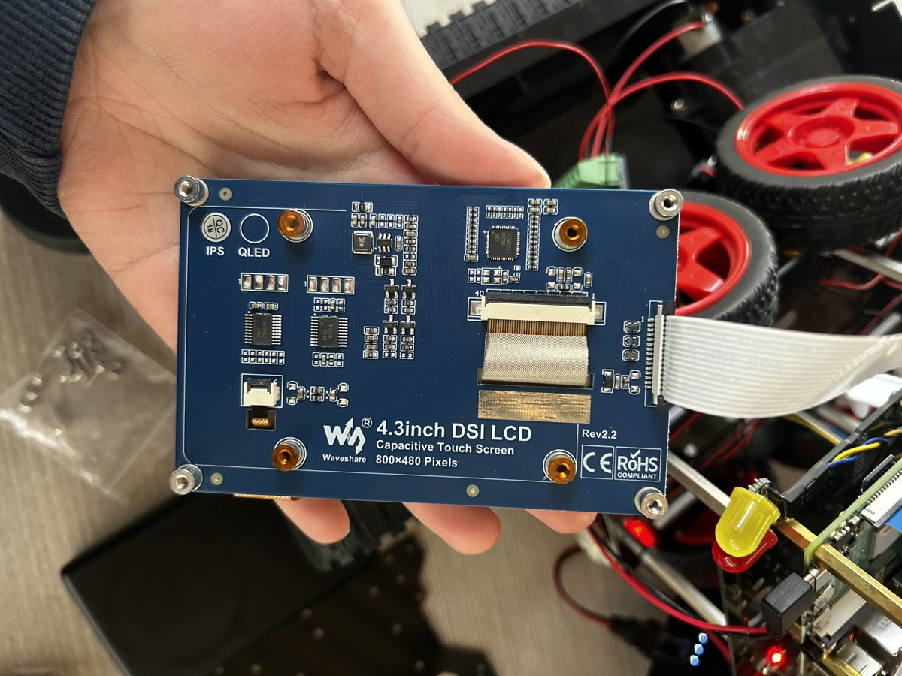

# LCD (Waveshare 4.3inch DSI LCD)

Raspberry Pi 4 의 DSI 단자에 연결하는 4.3인치 터치 화면 정리입니다.
코드: `aicar/gi.py`, `aicar/gi_servo.py` (주행 화면 `Out` 창을 띄우는 부분)

<p align="center"></p>

> 이 문서는 **보드 사진**, **코드에서 확인한 것**, **판매처(Waveshare) 자료**를 구분해 적었습니다.
> Pi 에서 실제로 확인하지 않은 항목은 **(미확인)** 으로 표시했습니다. 확인한 뒤 고쳐 주세요.

> **계획서 기준으로 최종 로봇에는 LCD 를 쓰지 않습니다**([PROJECT_PLAN.md](PROJECT_PLAN.md)). 화면은 Wi-Fi 원격 접속(VNC)으로 봅니다.
> 이 LCD 는 기존 자율주행차 키트 구성품이며, 개발 중 Pi 상태 확인용으로만 씁니다.

## 1. 보드 정보 (사진에서 확인)

| 항목 | 내용 |
|------|------|
| 보드 인쇄 | `Waveshare`, `4.3inch DSI LCD`, `Capacitive Touch Screen`, `800×480 Pixels`, `Rev2.2` |
| 패널 표시 | `IPS` 칸에 QC 스티커 → IPS 패널 |
| Pi 연결 | 오른쪽 15핀 FFC 커넥터 (회색 케이블) |
| 패널 연결 | 가운데 40핀 FPC 커넥터 (화면 패널 쪽, 건드리지 않음) |
| 고정 | 네 모서리 스탠드오프 + Pi 고정용 구리 스탠드오프 4개 |

## 2. 사양 (판매처 자료)

| 항목 | 값 |
|------|-----|
| 크기 / 해상도 | 4.3인치 / 800 × 480 |
| 패널 | IPS |
| 터치 | 정전식, 최대 5점 |
| 인터페이스 | MIPI DSI (Pi 의 DSI 단자, 15핀 FFC) |
| 전원 | DSI 케이블로 Pi 에서 공급 (별도 전원선 없음) (미확인) |
| 밝기 조절 | Rev2.1 이후 소프트웨어 조절 지원 (미확인) |
| 호환 | Raspberry Pi 4B / 3B+ / 3A+ / CM 계열 |

## 3. 연결

1. **전원을 끈 상태에서** 15핀 케이블을 Pi 4 의 DSI 단자(`DISPLAY`, SD 카드 쪽 가장자리)에 꽂습니다.
   카메라 단자(`CAMERA`, HDMI 옆)와 모양이 같으니 헷갈리지 않게 합니다.
2. 케이블의 금속 접점 방향을 양쪽 커넥터 모두 확인하고 잠금 탭을 끝까지 누릅니다.
3. 스탠드오프로 Pi 를 LCD 뒷면에 고정합니다.
4. Pi 를 켭니다. 화면이 안 나오면 4절 설정을 확인합니다.

## 4. Pi 설정 (미확인)

2026-11-05 기록은 **Debian 11 (Bullseye) + Legacy Camera 스택**(`start_x=1`) 기준입니다. 2026-11-06 현재 환경은 libcamera/Picamera2로 변경했습니다([카메라 인식 이슈](issues/2026-11-06-ov5647-camera.md)). 아래 LCD 설정과 현재 카메라 설정의 조합은 별도로 검증하지 않았습니다.
판매처 안내는 Bullseye 이후 기준으로 `/boot/config.txt` 에 아래 두 줄을 넣고 재부팅합니다.

```
dtoverlay=vc4-kms-v3d
dtoverlay=vc4-kms-dsi-7inch
```

- 이미 화면이 나오면 아무것도 고치지 않습니다.
- 위 설정을 바꾼 뒤에는 카메라가 그대로 잡히는지 다시 확인합니다(`VideoCapture(0,CAP_V4L).read()` 가 `True`). Legacy Camera 스택과 함께 쓸 때 문제가 없는지는 확인하지 않았습니다.
- 밝기 조절(Rev2.1 이후):
  ```bash
  ls /sys/class/backlight/                         # 장치 이름 확인
  echo 128 | sudo tee /sys/class/backlight/*/brightness   # 0 ~ 255
  ```

## 5. 코드와의 관계 (코드에서 확인)

주행 프로그램의 화면 창이 이 LCD 해상도에 맞춰져 있습니다.

| 파일 | 위치 | 내용 |
|------|------|------|
| `aicar/gi_servo.py` | 355줄 | `viewWin = np.zeros((480,800,3),np.uint8)` — 800 × 480 창 |
| `aicar/gi_servo.py` | 359~360줄 | `Out` 창을 전체화면으로 띄움 |
| `aicar/gi_servo.py` | 521~524줄 | 왼쪽 80px·오른쪽 80px 메시지 칸, 가운데 640 × 480 카메라 영상 |
| `aicar/gi_servo.py` | 624줄 | `cv.imshow('Out', viewWin)` |

- 조작 키는 `Out` 창을 클릭(터치)해 포커스를 준 뒤 입력합니다([DC_moter.md](DC_moter.md) 4절).
- LCD 를 떼고 VNC 로 볼 때도 창 크기는 같습니다. VNC 해상도를 800 × 480 이상으로 두면 잘리지 않습니다.

## 6. 문제 해결

| 증상 | 확인할 것 |
|------|-----------|
| 화면이 안 켜짐(백라이트도 꺼짐) | 케이블 방향·잠금 탭, DSI 단자에 꽂았는지(카메라 단자 아님) |
| 백라이트만 켜지고 검은 화면 | 4절 `config.txt` 설정 |
| 터치가 안 됨 | 케이블 재장착. 터치 신호도 DSI 케이블로 전달됨 (미확인) |
| 화면이 잘림 / 작게 나옴 | 해상도가 800 × 480 인지 확인 |
