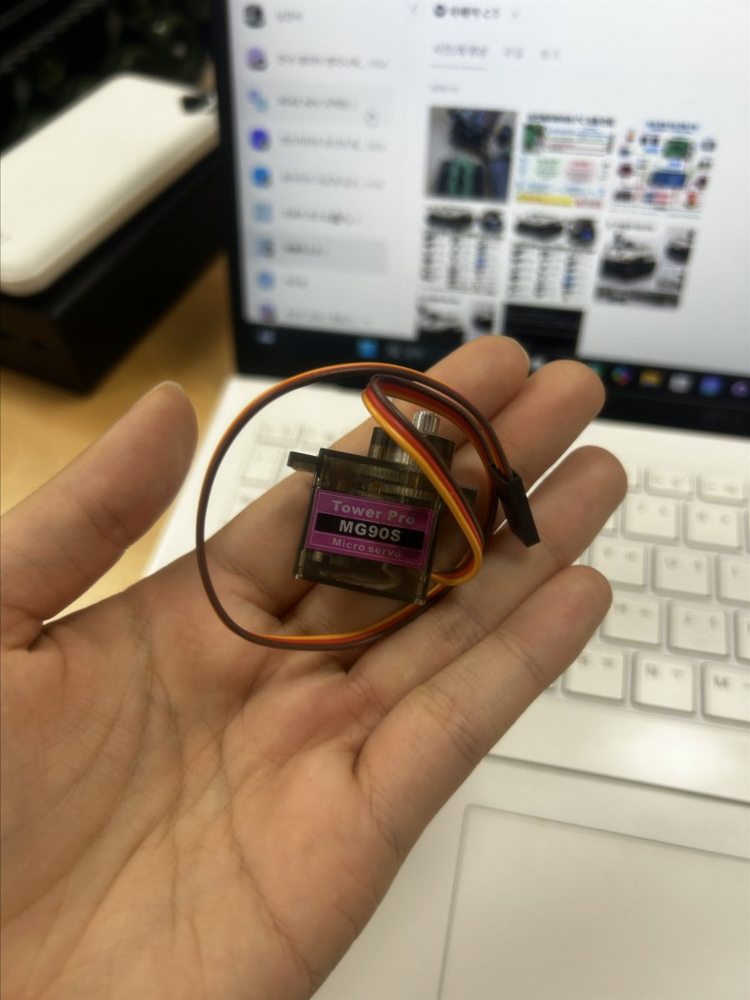

# 서보모터 (MG90S)

Tower Pro MG90S(180도형) 서보모터 2개를 Raspberry Pi 4 에서 키보드로 조작하는 방법입니다.
코드: `aicar/gi_servo.py` (주행 프로그램 + 서보 조작), `aicar/script/mg90s_test.py` (서보 단독 테스트)

<p align="center"></p>

| 항목 | 내용 |
|------|------|
| 모델 | Tower Pro MG90S Micro servo (금속 기어) |
| 종류 | 180도형 (위치 제어). 신호 길이로 각도가 정해짐 |
| 선 | 갈색 = GND, 빨강 = 5V, 주황 = 신호 |
| 신호 | 50Hz, 펄스 0.5ms(0도) ~ 2.5ms(180도) (데이터시트) |

## 1. 배선

| 서보 선 | servo1 | servo2 |
|---------|--------|--------|
| 주황 (신호) | **물리 11번** = GPIO17 = 확장보드 **P17** | **물리 13번** = GPIO27 = 확장보드 **P27** |
| 빨강 (+) | 5V (물리 2번 또는 4번) | 5V |
| 갈색 (−) | GND (물리 6·9·14·20·25·30·34·39번 중 아무거나) | GND |

- 선은 Pi 전원을 끈 상태에서 꽂습니다.
- 11번 핀 바로 위의 **9번**, 13번 핀 맞은편의 **14번이 GND** 라 꽂기 편합니다.
- 2026-10-29 까지는 32·33번(GPIO12·13)에 꽂았지만, 그 핀은 DC 모터 속도 신호 핀이라 `gi.py`를 실행하면
  서보가 엉뚱하게 움직이고 버텼습니다. 그래서 11·13번으로 옮겼습니다. **32·33번에 꽂혀 있으면 옮기세요.**

### 핀 정보

| 물리 번호 | GPIO(BCM) | 기능 이름 | 확장보드 글씨 | 코드 이름 | 연결 |
|-----------|-----------|-----------|---------------|-----------|------|
| **11번** | **GPIO17** | 일반 GPIO | **P17** | `SERVO1_PIN = 17` | servo1 주황(신호) |
| **13번** | **GPIO27** | 일반 GPIO | **P27** | `SERVO2_PIN = 27` | servo2 주황(신호) |
| 2번 / 4번 | – | 5V | 5V | – | 서보 빨강(+) |
| 6·9·14·20·25·30·34·39번 | – | GND | GND | – | 서보 갈색(−) |

같은 핀을 부르는 이름이 여러 개입니다.

| 이름 | 뜻 | 쓰는 곳 |
|------|-----|---------|
| 물리 번호 | 핀 헤더에서 몇 번째 자리인지 (1~40) | 선 꽂을 위치 찾기 |
| GPIO(BCM) 번호 | 칩 안의 신호 번호 | 코드 (`SERVO1_PIN = 17` = GPIO17) |
| 기능 이름 | 그 핀이 할 수 있는 일 (GPIO12·13 = PWM0·1 하드웨어 펄스용, 17·27 = 일반) | 데이터시트·핀맵 |
| 확장보드 글씨 | 보드에 인쇄된 이름, GPIO 번호와 같음 (P17 = GPIO17) | 확장보드에 꽂을 때 |

서보 신호는 gpiozero 가 소프트웨어로 만들기 때문에 PWM 전용 핀이 아닌 일반 GPIO(17·27)에서도 됩니다.
남는 핀으로 GPIO22(물리 15번)도 쓸 수 있습니다. 바꾸려면 `gi_servo.py`의 `SERVO1_PIN`, `SERVO2_PIN` 두 줄만 고칩니다.

### 핀 위치 (Raspberry Pi 4, 40핀 헤더)

- 핀은 2줄 × 20개. **바깥쪽(기판 가장자리) 줄 = 짝수**, 안쪽 줄 = 홀수.
- **1·2번은 USB 포트 반대쪽 끝**에 있습니다.
- 11번 = 안쪽 줄 6번째, 13번 = 안쪽 줄 7번째 (1번에서 세어서).

```
          안쪽(홀수)   바깥쪽(짝수)
  USB 반대쪽 끝
              1  ●  ●  2   5V   ← 서보 빨강
              3  ●  ●  4   5V
              5  ●  ●  6   GND  ← 서보 갈색
              7  ●  ●  8
        GND   9  ●  ●  10
  servo1 주황 → 11 ●  ●  12
  (GPIO17, P17)
  servo2 주황 → 13 ●  ●  14  GND
  (GPIO27, P27)
             15  ●  ●  16       (15 = GPIO22, 남는 핀)
                 ...
             31  ●  ●  32  GPIO12 = DC 모터 왼쪽 PWM (서보 꽂지 않음)
             33  ●  ●  34       (33 = GPIO13 = DC 모터 오른쪽 PWM)
                 ...
             39  ●  ●  40
  USB 포트 쪽 끝
```

> 이 저장소의 다른 GPIO: DC 모터 방향 GPIO5(29번)·GPIO6(31번), CdS 빛 센서 GPIO25(22번). 서보 배선 때 건드리지 않습니다.

> 서보(GPIO17·27)와 DC 모터(GPIO12·13 속도, GPIO5·6 방향)는 핀이 겹치지 않아 `gi_servo.py`에서 둘 다 동작합니다.
> DC 모터 핀은 [DC_moter.md](DC_moter.md) 2절.

## 2. 조작 키 (`gi_servo.py`)

카메라 화면 창(`Out`)을 **마우스로 한 번 클릭한 뒤** 누릅니다. 터미널을 클릭한 상태에서는 키가 먹지 않습니다.
servo1 은 숫자 줄(1~5), servo2 는 그 바로 아래 줄(Q~T)을 같은 순서로 씁니다.

| 동작 | servo1 (11번 핀) | servo2 (13번 핀) |
|------|:---:|:---:|
| 왼쪽으로 계속 (정지 키 또는 끝까지) | `1` | `Q` |
| 오른쪽으로 계속 (정지 키 또는 끝까지) | `2` | `W` |
| 왼쪽으로 10도 가고 멈춤 | `3` | `E` |
| 오른쪽으로 10도 가고 멈춤 | `4` | `R` |
| 정지 (신호를 바로 끊어 힘을 풂) | `5` | `T` |
| 두 서보 모두 정지 | `0` | `0` |

예: `3` → 100도, `3` → 110도, `4` → 100도, `1` → 왼쪽으로 천천히 계속(약 1초에 60도) → `5` 로 그 자리에서 멈춤.
0도·180도 끝에서는 더 가지 않습니다. 프로그램을 켠 직후에는 서보 위치를 알 수 없어서 90도를 기준으로 계산하므로,
첫 키를 누를 때 서보가 그 각도로 한 번 튈 수 있습니다.
이동한 뒤 1.5초(`SERVO_HOLD_SEC`)가 지나면 신호를 끊어 그 자리에서 힘을 풉니다. 신호를 계속 주면 이 서보가
위치를 못 잡고 "막힌 듯" 버티며 떨었기 때문입니다. 신호를 끊어도 마지막 각도는 기억하므로 정지 후에도 이동 키는 이어서 됩니다.
| 프로그램 종료 | `ESC` / `x` | |

- 프로그램을 켜도 서보는 이동 키를 누르기 전까지 움직이지 않습니다.
- 숫자 키패드(NumLock 켬)의 숫자도 됩니다. 대소문자 상관없습니다.
- 키를 누를 때마다 터미널에 `[서보] servo1(P17) 왼쪽 100도` 처럼 출력됩니다.

## 3. 코드 설명 (`gi_servo.py` 서보 부분)

### 설정값 (파일 위쪽 "서보모터 초기화")

| 이름 | 기본값 | 뜻 · 바꿀 때 |
|------|--------|--------------|
| `SERVO_MIN` / `SERVO_MAX` | 0 / 180 | 움직일 수 있는 각도 범위 |
| `SERVO_SWEEP_STEP` | 2 | "계속" 중 화면 1장마다 움직이는 각도 (약 1초에 60도). 크게 하면 빨라짐 |
| `SERVO_CENTER` | 90 | 프로그램 시작 직후 기준 각도 (서보 위치를 알 수 없어서) |
| `SERVO_STEP` | 10 | "10도" 키 1회 회전량 |
| `SERVO_HOLD_SEC` | 1.5 | 이동 후 신호를 끊기까지 시간(초). 짧으면 목표에 닿기 전에 끊겨 "가다 멈춤" (0.5초일 때 그랬음). 그래도 다 못 가면 늘림 |
| `SERVO_LEFT` | 1 | 왼쪽 = 각도 증가. **실제 왼쪽·오른쪽이 반대면 `-1`** |
| `SERVO_MIN_PULSE` / `SERVO_MAX_PULSE` | 0.0006 / 0.0024 | 0도 / 180도에 해당하는 펄스 폭(초) |

펄스 폭을 넣은 이유: gpiozero 기본값(1~2ms)이면 0~180도를 명령해도 실제로는 약 90도만 움직입니다.
데이터시트 값(0.5~2.5ms)으로는 이 서보가 180도 끝에서 기계적 한계에 닿아 계속 버텼기 때문에(2026-10-29 시험),
0.6~2.4ms 로 줄였습니다. 아직 끝에서 버티면 0.0007 / 0.0023 처럼 더 안쪽으로 줄입니다.

### 함수

| 함수 | 하는 일 |
|------|---------|
| `servoInit(pin, name)` | 서보 생성. `initial_angle=None` 이라 신호를 보내지 않음 → 켜자마자 튀지 않음. 실패하면 `None` 반환하고 주행은 계속 |
| `servoSet(servo, name, angle, label)` | 실제로 각도를 보내는 곳. 오류가 나도 프로그램을 멈추지 않고 원인만 출력 |
| `servoMoveTo` | 각도로 이동 → `SERVO_HOLD_SEC` 뒤 `threading.Timer` 로 신호 끊음. 마지막 각도는 `servoAngle` 에 기억 |
| `servoKeepTurning` / `servoSweepStep` | "계속" 키: 방향을 기록하고, 메인 루프가 화면 1장마다 `SERVO_SWEEP_STEP` 도씩 움직임. 끝에 닿으면 멈추고 신호 끊음 |
| `servoStop` | 정지 키: 타이머 취소하고 신호 바로 끊음 (이동 키는 바로 다시 사용 가능) |
| `servoTurn(servo, name, direction, step)` | 마지막 각도에서 `direction`(+1 왼쪽 / -1 오른쪽)으로 `step` 도 더. 범위 끝에서 멈춤. 시작 전이면 안내만 출력 |

## 4. 라즈베리파이에 업로드하고 실행

### 접속 정보

| 항목 | 값 |
|------|-----|
| 사용자 | `pi` |
| 비밀번호 | 팀에서 공유받은 값 (문서에 적지 않음) |
| IP | `192.168.137.242` (2026-10-29 노트북 핫스팟 기준, 바뀔 수 있음) |

IP 확인: Pi 터미널에서 `hostname -I`

### 처음 한 번: Pi 에서 SSH 켜기 (Pi 터미널)

```
sudo systemctl enable --now ssh
```

### 업로드 (노트북 PowerShell)

`gi_servo.py`는 `aicar/script/power_check.py`를 불러 쓰므로 `script` 폴더도 같이 보냅니다.

```
scp C:\AutoTank\aicar\gi_servo.py pi@192.168.137.242:/home/pi/aicar/
scp -r C:\AutoTank\aicar\script pi@192.168.137.242:/home/pi/aicar/
```

- 처음이면 `yes` 입력 → 비밀번호 입력 (글자가 안 보이는 게 정상, **한/영 키 영어 상태** 확인)
- `gi_servo.py 100%`, `power_check.py 100%` 등이 나오면 완료
- `script` 폴더 안: `power_check.py`(전압 확인), `servo_test.py`(배선 점검), `mg90s_test.py`(서보 단독 테스트)
- Pi 쪽 기존 파일을 덮어쓰므로, 필요하면 먼저 Pi 에서 백업: `cp ~/aicar/gi_servo.py ~/aicar/gi_servo_backup.py`

### 실행 (Pi 터미널 또는 `ssh pi@192.168.137.242` 로 접속한 터미널)

```
cd ~/aicar
python3 gi_servo.py      # 카메라 + 화면 창 필요 (VNC 또는 Pi 모니터)
python3 script/mg90s_test.py    # 서보만 테스트, 카메라·화면 없이 SSH 터미널에서도 됨
```

`mg90s_test.py` 조작: 자동 점검(0→45→90→135→180→90도, 0↔180 왕복) 후 `키>` 에서
`d` +10도, `a` -10도, `s` 90도, 숫자 = 그 각도, `q` 종료 (입력 후 Enter).

## 5. 문제 해결

| 증상 | 원인 · 확인 |
|------|-------------|
| `Connection refused` (scp) | Pi 에서 SSH 꺼짐 → 4절 SSH 켜기 |
| `Permission denied` (scp) | 비밀번호 틀림 · 한글 입력 상태 |
| 키를 눌러도 반응 없음 | `Out` 창 클릭 안 함, 카메라 미연결(화면 창이 안 뜸) |
| 터미널엔 각도가 나오는데 서보가 안 움직임 | 배선(신호 11·13번 핀, 5V, GND), `gi.py`가 뒤에서 실행 중인지 (`ps aux \| grep gi`) |
| 약 90도만 움직임 | `SERVO_MIN_PULSE` / `SERVO_MAX_PULSE` 확인 |
| 떨림 · Pi 재부팅 · `[전원 경고]` · 빨간 LED 깜빡임 | 전원 부족 → 5V 3A 어댑터, 또는 서보 외부 5V 전원(GND 공통) |
| 끝(0도·180도)에서 "끼익"·덜덜 떨며 계속 더 가려고 버팀 | 펄스 폭이 서보의 기계적 한계보다 바깥쪽 → `SERVO_MIN_PULSE`/`SERVO_MAX_PULSE` 를 안쪽으로. 급하면 프로그램 종료(ESC) |
| 정지 키 후에도 계속 빙글빙글 돎 | 360도 회전형 서보 → 제어 방식이 달라 코드 수정 필요 |
| 왼쪽·오른쪽이 반대 | `SERVO_LEFT = -1` |
