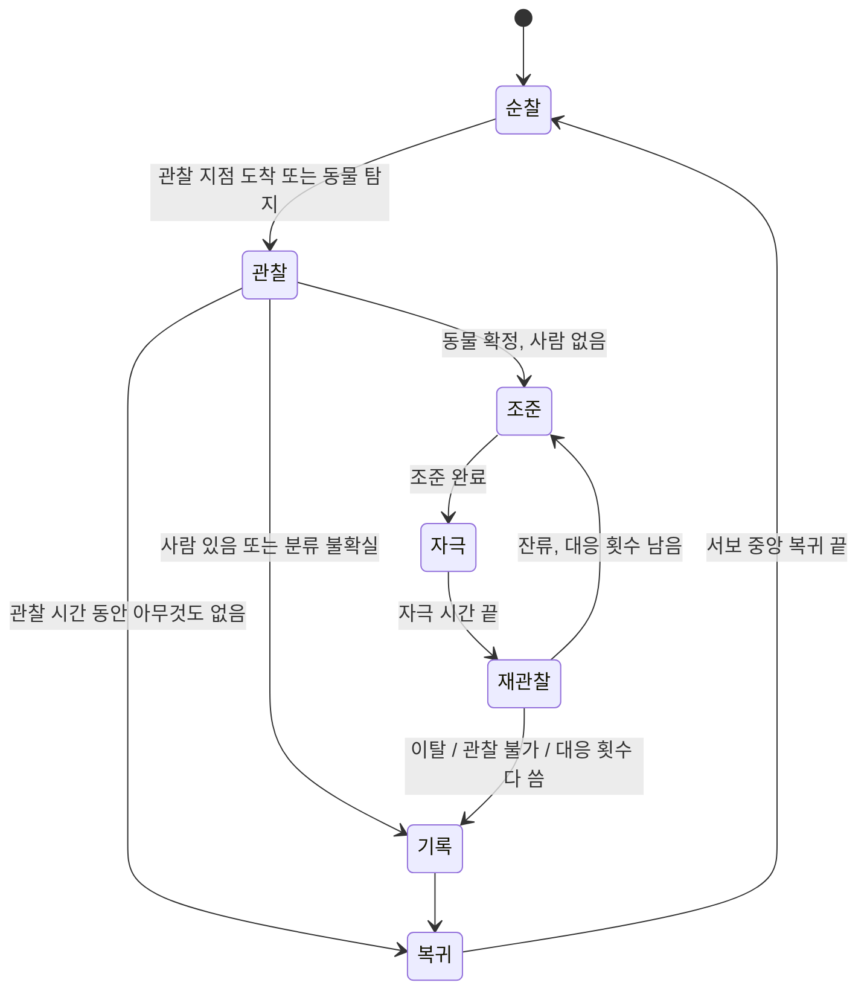

# 주행 비즈니스 규칙

순찰 로봇이 주행하면서 "무엇을 보면 어떻게 움직이는가"를 정한 규칙 모음입니다.
코드를 고치기 전에 이 폴더의 규칙을 먼저 고치고, 코드는 규칙을 따릅니다.
배경과 목표는 [PROJECT_PLAN.md](../planning/PROJECT_PLAN.md)를 따릅니다.

| 파일 | 내용 |
|------|------|
| [README.md](README.md) | 이 안내서: 우선순위, 상태 흐름, 규칙 고치는 법 |
| [driving-rules.md](driving-rules.md) | 규칙 본문. 지금 있는 기능과 구현할 기능을 모두 담고, 규칙마다 반영 구분을 붙임 |
| [parameters.md](parameters.md) | 규칙에 쓰는 숫자 전부 (값은 이 파일에서만 고칩니다) |

규칙들이 이어져서 실제로 어떻게 움직이는지는 [시나리오](../scenarios/README.md), 모듈과 장치가 주고받는 형식은 [인터페이스 명세](../software/interfaces.md)에 있습니다.

## 1. 우선순위

위에 있는 규칙이 아래 규칙을 이깁니다. 두 규칙이 부딪히면 이 표로 정합니다.

| 순위 | 구분 | 예 |
|:----:|------|----|
| 1 | 수동 정지, 종료 | `[Space]` 정지, `[X]` 종료 |
| 2 | 장애물 정지 | VL53L0X 거리 < `STOP_DISTANCE` |
| 3 | 사람 보호 | 사람이 보이면 자극 금지, 서보 조준 금지 |
| 4 | 수동 서보 조작 | 서보 키를 누르면 자동 조준을 잠시 멈춤 |
| 5 | 동물 대응 | 정차, 조준, 자극, 재관찰 |
| 6 | 주행 | CNN 조향 자율주행 |

## 2. 상태 흐름

로봇은 항상 아래 상태 중 하나에 있습니다. 규칙 본문의 "언제" 칸은 이 상태 이름을 씁니다.



| 상태 | 하는 일 | 바퀴 | 서보 |
|------|---------|------|------|
| 순찰 | 지정 경로를 자율주행 | 움직임 | 중앙 고정 |
| 관찰 | 정차하고 여러 프레임으로 탐지 확인 | 정지 | 중앙 고정 |
| 조준 | 동물 쪽으로 서보를 돌림 | 정지 | 동물 추적 |
| 자극 | 음향 / 음향과 LED를 정해진 시간만 출력 | 정지 | 동물 추적 |
| 재관찰 | 같은 자리에서 대상이 남았는지 확인 | 정지 | 마지막 각도 유지 |
| 기록 | 이벤트 저장, 필요하면 관리자 알림 | 정지 | 유지 |
| 복귀 | 서보를 중앙으로 돌리고 순찰 재개 준비 | 정지 | 중앙으로 이동 |

장애물 정지와 수동 정지(우선순위 1, 2)는 어느 상태에서든 바로 끼어듭니다.

## 3. 규칙 읽는 법

규칙 하나는 아래 표 하나입니다. 모든 칸을 채우고, 모르는 칸은 `결정 필요`라고 적습니다.

```markdown
### [미반영] AIM-02 규칙 이름

| 항목 | 내용 |
|------|------|
| 언제 | 어떤 상태에서 확인하는가 (2절 상태 이름) |
| 조건 | 무엇이 참이면 실행하는가 |
| 동작 | 로봇이 무엇을 하는가 |
| 예외 | 실행하지 않는 경우 |
| 값 | 쓰는 파라미터 이름 (숫자는 parameters.md 에만) |
| 구현 | 코드 위치, 없으면 "없음" |
```

제목 맨 앞의 반영 구분:

| 구분 | 뜻 | 예 |
|------|----|----|
| `[초기반영]` | 원본 aicar 코드에 처음부터 있던 동작 | 자율주행 조향, 장애물 정지, 신호등 |
| `[후기반영]` | 이후 팀이 추가해서 지금 코드에 있는 동작 | 서보 수동 조작, YOLO 탐지, 전원 경고 |
| `[미반영]` | 아직 코드에 없어서 구현해야 할 동작 | 동물 쪽 자동 조준, 자극 선택, 재관찰 |

한 규칙 안에 "있는 부분"과 "없는 부분"이 섞이면 규칙을 둘로 나눕니다. 구분 하나가 규칙 하나를 정확히 가리키게 하기 위해서입니다.

규칙 번호 앞자리:

| 앞자리 | 분야 |
|--------|------|
| `DRV` | 주행 (자율주행, 수동 주행, 정차) |
| `SAFE` | 안전 (정지, 사람 보호, 전원, 종료) |
| `DET` | 탐지 판정 (동물, 사람, 불확실) |
| `AIM` | 서보 (서보 1 위아래, 서보 2 좌우) |
| `LAMP` | 램프와 소리 (방향지시등, 전조등, 경적) |
| `STIM` | 자극 선택과 출력 |
| `OBS` | 재관찰과 결과 판정 |
| `LOG` | 기록과 알림 |
| `COL` | 학습 데이터 수집 |

## 4. 규칙을 고칠 때

1. 숫자만 바꾸면 [parameters.md](parameters.md)의 값과 "근거" 칸만 고칩니다. 규칙 본문은 그대로 둡니다.
2. 규칙을 새로 만들면 그 분야의 다음 번호를 쓰고, driving-rules.md 맨 위 "한눈에 보기" 표와 합계에도 한 줄 넣습니다. 지운 번호는 다시 쓰지 않습니다.
3. 규칙을 없애면 지우지 말고 제목 끝에 `(폐지, 날짜, 이유)`를 붙여 둡니다. 코드 주석이 그 번호를 가리키고 있을 수 있습니다.
4. `[미반영]` 규칙을 구현하면 제목과 "한눈에 보기" 표의 구분을 `[후기반영]`으로 바꾸고, "구현" 칸에 위치를 적고, 코드 근처 주석에 규칙 번호를 적습니다(예: `# AIM-02`).
5. 우선순위(1절)나 상태 흐름(2절)이 바뀌면 이 파일도 함께 고칩니다.

## 5. 용어

| 용어 | 뜻 |
|------|----|
| 목표 동물 | YOLO 클래스 `roe_deer`(노루), `wild_boar`(멧돼지). 대표 시나리오는 고라니 |
| 확정 | 한 프레임이 아니라 정해진 시간 동안 계속 보여서 믿을 수 있는 탐지 |
| 불확실 | 보이긴 하지만 신뢰도가 확정 기준보다 낮은 탐지 |
| 화면 중심 오차 | 탐지 박스 중심이 카메라 화면(640×480) 가운데에서 떨어진 거리 |
| 대응 1회 | 조준, 자극, 재관찰을 한 번 도는 것 |
