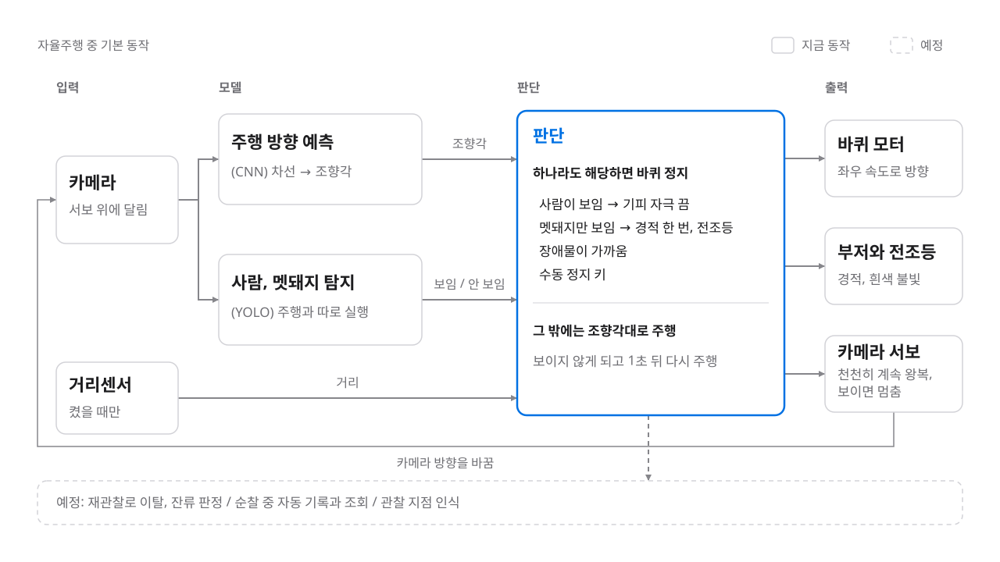

# 인터페이스 명세

모듈과 장치가 서로 무엇을, 어떤 형식으로 주고받는지 적은 문서입니다.
"언제 무엇을 하나"는 [비즈니스 규칙](../business-rules/README.md), "어떻게 이어지나"는 [시나리오](../scenarios/README.md)에 있고, 이 문서는 그 사이의 약속만 적습니다.
한쪽을 바꾸면 다른 쪽이 깨지는 곳이 경계입니다. 경계를 바꿀 때는 이 문서부터 고치고, "바꿀 때 함께 고칠 곳"을 모두 고칩니다.

반영 구분은 규칙 문서와 같습니다: `[초기반영]` 원본 aicar, `[후기반영]` 팀이 추가해서 지금 있음, `[미반영]` 구현할 것.

## 1. 경계 한눈에 보기

<p align="center">
  
</p>

그림 원본은 [images/interfaces-boundary.svg](images/interfaces-boundary.svg)입니다. 텍스트 파일이라 상자마다 `<!-- IF-05 -->` 같은 주석을 찾아 바로 고칠 수 있습니다. 경계가 바뀌면 그림도 함께 고칩니다.

| 번호 | 경계 | 형식 | 구분 |
|------|------|------|------|
| IF-01 | 카메라 → 프로그램 | 영상 배열 | `[후기반영]` |
| IF-02 | 주행 사진 (gi.py → dl.py → 학습) | 파일 이름 규약, 전처리 | `[초기반영]` |
| IF-03 | 주행 모델 → ar.py | `.pt` 파일, 입출력 텐서 | `[초기반영]` |
| IF-04 | YOLO 모델 → ar.py | 폴더 구조, 클래스 이름 | `[후기반영]` |
| IF-05 | ar.py ↔ 탐지 모듈 | Python 함수 | `[후기반영]` |
| IF-06 | 프로그램 → 전원 확인 | Python 함수 | `[후기반영]` |
| IF-07 | Pi ↔ 부품 (GPIO, I²C) | 핀, 전압 | `[초기반영]` + `[후기반영]` |
| IF-08 | 판단 → 서보 조준 | Python 함수 | `[후기반영]` 뼈대 |
| IF-09 | 판단 → 자극 출력 | Python 함수 | `[후기반영]` 뼈대 |
| IF-10 | 판단 → 이벤트 기록 | 파일 형식 | `[후기반영]` 뼈대 |
| IF-11 | 기록 → 원격 조회 화면 | HTTP API | `[후기반영]` API만 |
| IF-12 | 설정 GUI ↔ ar.py | 파일 (설정, 명령, 상태) | `[후기반영]` |

"뼈대"는 함수는 있지만 규칙의 상태 흐름(관찰 → 조준 → 자극 → 재관찰 → 기록)에는 아직 연결되지 않았다는 뜻입니다. 지금은 설정 GUI 실험 버튼과 `AIM_AUTO` 설정으로 시험합니다.

### 주행 중 판단 흐름

<p align="center">
  
</p>

위 경계 그림이 파일과 모듈 사이의 약속이라면, 이 그림은 주행 중에 무엇을 보고 어떻게 움직이는지를 역할 이름으로 보여 줍니다(중간발표 구조 그림). 카메라는 IF-01, 주행 방향 예측은 IF-03, 탐지는 IF-04와 IF-05, 출력은 IF-07과 IF-08에 해당합니다.
그림 원본은 [images/drive-pipeline.svg](images/drive-pipeline.svg)입니다. 판단 규칙이 바뀌면 그림도 함께 고칩니다.

---

## IF-01 카메라 → 프로그램 `[후기반영]`

| 항목 | 내용 |
|------|------|
| 보내는 쪽 | OV5647 CSI 카메라 (Picamera2, libcamera) |
| 받는 쪽 | `aicar/ar.py`, `aicar/gi.py`, `aicar/od.py` |
| 형식 | `numpy` 배열, 모양 `(480, 640, 3)`, `uint8`, 색 순서 BGR (Picamera2 `RGB888`이 OpenCV용 BGR 순서로 나옴) |
| 받는 방법 | `camera.capture_array("main")`, 화면 1장마다 1번 |
| 실패하면 | 모양이 다르거나 `None`이면 `RuntimeError`로 멈춤 |
| 바꿀 때 함께 고칠 곳 | 해상도를 바꾸면 IF-03 자르는 창(`WIN_*`), IF-05 박스 좌표 기준, 규칙 AIM-02 계산식(320, 240)을 모두 고침 |

## IF-02 주행 사진 (gi.py → dl.py → 학습) `[초기반영]`

| 항목 | 내용 |
|------|------|
| 보내는 쪽 | `aicar/gi.py` 모드 1 주행 이미지 (규칙 COL-01). 모드 2 객체 탐지 이미지는 원본 640×480을 `aicar/yolo_raw/<날짜>/`에 저장하고 `aicar/label.py`로 라벨링 |
| 받는 쪽 | `aicar/dl.py`, `yolo/train/train_all.ipynb` 1부 (`aicarA.ipynb`와 같음) |
| 저장 위치 | `aicar/<프로젝트>/` |
| 파일 이름 | `P0001__+12.png`: 시작 문자 1, 번호 4자리, 빈칸 2자리(`__`, 증강 라벨용, 예 `_R`), 부호, 조향각 2자리 |
| 이미지 | 카메라 화면에서 `WIN_XL~WIN_XR`, `WIN_YU~WIN_YD` 영역을 잘라 200×66으로 줄이고, BGR → YUV, 3×3 가우시안 블러 |
| 실패하면 | 파일 이름 규약이 다르면 dl.py가 조향각을 읽지 못함 |
| 바꿀 때 함께 고칠 곳 | 전처리(자르는 창, 크기, 색, 블러)를 바꾸면 IF-03의 ar.py 전처리도 똑같이 바꾸고 다시 학습. 둘이 다르면 모델은 학습 때 본 적 없는 영상을 받음 |

## IF-03 주행 모델 → ar.py `[초기반영]`

| 항목 | 내용 |
|------|------|
| 보내는 쪽 | `train_all.ipynb` 1부 |
| 받는 쪽 | `aicar/ar.py` |
| 파일 | `_<프로젝트>_model_check.pt` (PyTorch `state_dict`, `NvidiaModel` 구조) |
| 찾는 위치 | `~/Downloads/_<프로젝트>_*.pt`와 `aicar/<프로젝트>/_<프로젝트>_*.pt`. 1개면 바로 읽고, 여러 개면 화면 목록에서 고름(최근 파일이 아래) |
| 입력 | IF-02와 같은 전처리를 한 영상을 0~1로 나눈 값, 텐서 모양 `(1, 3, 66, 200)` |
| 출력 | 실수 1개 = 조향각. ar.py가 `int(출력 × ANGLE_GAIN)`으로 바꿔 모터에 씀 (규칙 DRV-01) |
| 실패하면 | 파일이 없으면 수동 주행만 됨. `NvidiaModel` 구조가 다르면 `load_state_dict`에서 오류 |
| 바꿀 때 함께 고칠 곳 | 모델 구조를 바꾸면 노트북과 ar.py의 `NvidiaModel`을 같이 고침 |

## IF-04 YOLO 모델 → ar.py `[후기반영]`

다시 학습할 때 가장 깨지기 쉬운 경계입니다.

| 항목 | 내용 |
|------|------|
| 보내는 쪽 | `train_all.ipynb` 2부, 3부 |
| 받는 쪽 | `aicar/yolo_detect.py` (ar.py가 사용) |
| 전달 | `<프로젝트>_models.zip`을 `~/aicar/`에서 풀기 |
| 실패하면 | 폴더가 없거나 클래스가 다르면 터미널에 이유를 출력하고 탐지 없이 주행만 함 (규칙 DET-01) |

폴더 구조 (zip을 푼 뒤):

```
aicar/<프로젝트>/
  _<프로젝트>_model_check.pt           ← IF-03
  person_yolo26n_ncnn/                 ← 사람 모델
    model.ncnn.param  model.ncnn.bin  metadata.yaml
  animal_yolo26n_ncnn/                 ← 노루, 멧돼지 모델
    model.ncnn.param  model.ncnn.bin  metadata.yaml
```

| 모델 | 폴더 이름 | 입력 크기 | 쓰는 클래스 | 학습 |
|------|-----------|-----------|-------------|------|
| 사람 | `person_yolo26n_ncnn` | 416 | `person` | COCO 사전학습 그대로 (변환만) |
| 동물 | `animal_yolo26n_ncnn` | 640 | `wild_boar` (지금 시험용으로 멧돼지만. 노루는 `ANIMAL_NAMES`에 `roe_deer`를 다시 넣으면 씀) | 팀 데이터로 학습 |

클래스 번호와 이름 (`yolo/train/data.yaml`):

| 번호 | 이름 | 비고 |
|:---:|------|------|
| 0 | `person` | 동물 모델에도 있지만 쓰지 않음. 사람은 사람 모델로만 판단 |
| 1 | `roe_deer` | 노루 |
| 2 | `wild_boar` | 멧돼지 |

지켜야 할 약속:
- 라벨링 도구의 클래스 이름과 순서를 위 표와 똑같이 씁니다. `deer`, `boar`처럼 다르면 모델을 거부합니다.
- 입력 크기는 NCNN으로 변환할 때의 크기와 같아야 합니다(`metadata.yaml`의 `imgsz`).
- 폴더 이름을 바꾸면 탐지를 찾지 못합니다.

바꿀 때 함께 고칠 곳:

| 바꾸는 것 | 고칠 곳 |
|-----------|---------|
| 클래스 추가, 이름 변경 | `yolo/train/data.yaml`, `train_all.ipynb` 2부 `names`, `aicar/yolo_detect.py` `ANIMAL_NAMES`, 규칙 README 5절 "목표 동물" |
| 입력 크기 | `train_all.ipynb` `ANIMAL_IMGSZ`, `PERSON_IMGSZ`와 `aicar/yolo_detect.py` 같은 이름 상수 |
| 폴더 이름 | `train_all.ipynb` 3부, `aicar/yolo_detect.py` `PERSON_DIR`, `ANIMAL_DIR`, `yolo/models/README.md` |
| 두 모델을 하나로 합침 | `aicar/yolo_detect.py` `Detector` 전체, 이 표 |

## IF-05 ar.py ↔ 탐지 모듈 `[후기반영]`

`aicar/yolo_detect.py`. 탐지는 별도 스레드에서 돌고, 주행 루프는 기다리지 않습니다.

| 함수 | 입력 | 출력 | 실패하면 |
|------|------|------|----------|
| `hasModels(modelDir)` | 프로젝트 폴더 경로 | 두 모델 폴더가 모두 있으면 `True` | 없으면 `False` |
| `Detector(modelDir)` | 프로젝트 폴더 경로 | 탐지 객체 (스레드 시작) | 클래스가 다르면 `ValueError`, ultralytics가 없으면 `ImportError`. ar.py는 이것과 `OSError`, `RuntimeError`를 잡아서 탐지 없이 주행 |
| `submit(frame)` | IF-01 영상 1장 | 없음. 바로 돌아옴 | 탐지가 느리면 그 사이 영상은 건너뜀 (최신 1장만 유지) |
| `state()` | 없음 | `(사람 있음, 동물 있음, 박스 목록, 탐지 시간 mS)` | 없음 |
| `error` (속성) | | 탐지 스레드가 멈춘 원인, 정상이면 `None` | 멈추면 이후 `state()`는 시간이 지나 둘 다 `False`가 됨 (규칙 SAFE-08에서 보완) |

`state()` 출력:

| 값 | 형식 | 뜻 |
|----|------|----|
| 사람 있음 | `bool` | 마지막 사람 탐지에서 `DETECT_HOLD_SEC` 안이면 `True` |
| 동물 있음 | `bool` | 마지막 노루, 멧돼지 탐지에서 `DETECT_HOLD_SEC` 안이면 `True` |
| 박스 목록 | `[(x1, y1, x2, y2, 이름, 신뢰도), ...]` | 가장 최근 탐지 1회의 결과. 좌표는 IF-01 카메라 화면(640×480) 기준 정수, 신뢰도는 0~1 실수, `DETECT_CONF` 이상만 들어 있음 |
| 탐지 시간 | `int` (mS) | 가장 최근 탐지 1회(두 모델 합계)에 걸린 시간 |

예: `(True, True, [(410, 60, 520, 210, 'roe_deer', 0.83), (100, 40, 200, 400, 'person', 0.91)], 640)`

- ar.py 화면에 그릴 때는 왼쪽 메시지 상자 때문에 x에 80을 더합니다. 판단에는 더하지 않은 원래 좌표를 씁니다.
- `[미반영]` 규칙 SAFE-06, SAFE-08을 구현하려면 "가장 최근 탐지 결과의 시각"도 `state()`로 내보내야 합니다. 지금은 시간이 지나면 "사람 없음"과 "결과 없음"을 구분할 수 없습니다.

## IF-06 프로그램 → 전원 확인 `[후기반영]`

| 함수 | 입력 | 출력 | 실패하면 |
|------|------|------|----------|
| `checkPower(when='')` (`aicar/script/power_check.py`) | 출력에 붙일 시점 설명 (예: `'시작'`, `'주행 중'`) | 없음. 상태가 바뀌었을 때만 터미널에 정상 / 경고 출력 | `vcgencmd`를 못 읽으면 "읽을 수 없습니다"를 한 번 출력하고 계속 |
| `readThrottled()` | 없음 | `vcgencmd get_throttled` 값(정수) | 못 읽으면 `None` |

Pi 본체 전압만 봅니다. 서보 전원선이 빠진 것은 알 수 없습니다.

## IF-07 Pi ↔ 부품 `[초기반영]` + `[후기반영]`

배선은 이미 아래 문서에 있으므로 여기에는 위치만 적습니다.

| 부품 | 연결 | 문서 |
|------|------|------|
| DC 모터, 모터 드라이버 | GPIO 12, 13 (PWM), 5, 6 (방향) | [README GPIO 표](../../README.md#원본-코드-gpio-배선-bcm-번호), [DC_moter_driver.md](../hardware/DC_moter_driver.md) |
| 부저, 후진 사운드, 방향지시등, 브레이크 램프, CdS | GPIO 23, 24, 20, 26, 21, 25 | [README GPIO 표](../../README.md#원본-코드-gpio-배선-bcm-번호) |
| 서보 1 (위아래), 서보 2 (좌우) | GPIO 17, 27, 5V, GND `[후기반영]` | [Servo_moter.md](../hardware/Servo_moter.md) |
| VL53L0X 거리센서 | I²C | 원본 `VL53L0X.py` (저장소에 아직 없음) |
| 네오픽셀 전조등 | `NEOPIXEL.py` 설정 | 원본 `NEOPIXEL.py` (저장소에 아직 없음) |
| 카메라 | CSI | [IR_camera.md](../hardware/IR_camera.md), IF-01 |

규칙: 서보를 GPIO 12, 13에 꽂지 않습니다. 모터 PWM 신호를 받아 오동작합니다.

---

## IF-08 판단 → 서보 조준 `[후기반영]` (뼈대)

`aicar/aim.py`. 서보 핀은 ar.py 가 잡고 있으므로, 이 모듈은 각도만 계산하고 실제 이동은 ar.py 가 넘긴 함수(`aimMove`, `aimHold`)로 합니다.
지금은 설정 `AIM_AUTO`를 켜면, 자율주행이 꺼져 있고 바퀴가 멈춰 있을 때 가장 큰 동물 박스 쪽으로 조준합니다. 관찰, 조준 같은 상태 흐름은 아직 없습니다.

| 함수 | 입력 | 출력 | 실패하면 |
|------|------|------|----------|
| `computeAim(box, current, s)` | IF-05 박스 1개, 지금 `(tilt, pan)`, 설정 dict | 보낼 `(tilt, pan)` | 없음 (계산만) |
| `Aimer.aimAt(box, s, force=False)` | 박스, 설정 | 보낸 `(tilt, pan)`. `AIM_INTERVAL_SEC` 간격, 수동 조작 뒤 쉬는 시간 안이면 안 보냄 | 서보가 없으면 ar.py 쪽에서 원인만 출력 |
| `Aimer.moveTo(tilt, pan, s)` | 각도 | 범위로 자른 `(tilt, pan)` | 위와 같음 |
| `Aimer.aimCenter(s)` | 설정 | `(SERVO_CENTER, SERVO_CENTER)` | 위와 같음 |
| `Aimer.aimHold()` | 없음 | 없음. 그 자리에서 힘 풀기. 사람이 보이는 동안 ar.py 가 프레임마다 부름 | 위와 같음 |
| `Aimer.pause(sec)` | 초 | 없음. 그동안 자동 조준을 쉼 (AIM-06) | |
| `largestBox(boxes)` | 박스 목록 | 넓이가 가장 큰 박스, 없으면 `None` (DET-05) | |

- 각도 단위는 도(0~180). 서보 1 = 위아래(tilt, `AIM_TILT_MIN~MAX`), 서보 2 = 좌우(pan, `AIM_PAN_MIN~MAX`).
- 계산 순서는 규칙 AIM-02(목표 각도 → 범위 자르기 → 이동량 자르기)를 따릅니다. `AIM_CAMERA_ON_SERVO`로 카메라가 서보 위에 있는지 고릅니다.

## IF-09 판단 → 자극 출력 `[후기반영]` (뼈대)

`aicar/stimulus.py`의 `Stimulus` 클래스. ar.py 는 `stimulus` 객체 하나를 씁니다.

| 함수 | 입력 | 출력 | 실패하면 |
|------|------|------|----------|
| `start(kind, sec, s)` | `kind` = `'sound_a'`, `'sound_b'`, `'sound_led'`, `'led'`(LED만) 중 하나, `sec` = `STIMULUS_SEC`, 설정 | 켜면 `True`. 바로 돌아오고 `sec` 뒤 스스로 꺼짐 | 소리 파일이 없거나 재생 프로그램을 못 열면 `False`와 터미널에 원인. LED를 못 열면 소리만 |
| `stop()` | 없음 | 없음. 즉시 끄고 남은 시간도 지움 | 예외를 밖으로 내지 않고 출력만 (끄는 함수가 멈추면 안 되므로) |
| `active()` | 없음 | 켜져 있으면 `True` | |
| `close()` | 없음 | 끄고 LED 핀 해제. ar.py 종료 정리에서 부름 | 출력만 |

- 소리: `SOUND_PLAYER`(aplay 등)로 `SOUND_A_FILE`, `SOUND_B_FILE`을 재생합니다. 파일이 `sec`보다 짧으면 파일 길이만큼만 납니다. 소리 파일은 아직 없습니다. `aicar/sounds/` 안의 파일만 재생합니다(밖을 가리키면 거부).
- LED: `sound_led`일 때 `LED_PIN`(0이면 사용 안 함)을 `LED_BLINK_SEC` 간격으로 깜빡입니다. 핀은 빈 핀(4, 16, 19, 22)만 고를 수 있고, 모듈도 다른 장치가 쓰는 핀을 한 번 더 거부합니다.
- 사람이 보이면 ar.py 가 매 프레임 `stop()`을 부릅니다. 탐지가 꺼졌거나 멈춰도 끕니다(`ALLOW_WITHOUT_DETECT`로 시험 허용 가능). `[Space]`, `[End]`도 끕니다.
- 장애물 경고 경적(부저, GPIO 23)은 자극이 아닙니다. 이 함수들로 켜고 끄지 않습니다(규칙 SAFE-06 예외).

## IF-10 판단 → 이벤트 기록 `[후기반영]` (뼈대)

`aicar/event_log.py`의 `EventLog`. 항목은 규칙 LOG-01을 따릅니다. 지금은 설정 GUI의 [기록 남기기]로만 씁니다. 상태 흐름이 생기면 "기록" 상태에서 씁니다.

| 항목 | 내용 |
|------|------|
| 저장 위치 | `aicar/events/<날짜>.jsonl` (하루 1파일, 한 줄 = 이벤트 1건), 사진은 `aicar/events/<날짜>/<이벤트 번호>.jpg`. `events/`는 git에 넣지 않음 |
| 쓰는 함수 | `write(event, photo=None)` → 저장한 dict(`id`, `time`, `photo` 채움), 실패하면 `None`. `event`에 `species`와 `result` 필수 |
| 읽는 함수 | `listEvents(day, page, limit)`, `getEvent(id)`, `photoPath(day, name)` (IF-11이 사용) |
| 실패하면 | 저장 공간, 권한 오류를 터미널에 출력하고 순찰은 계속 (기록 실패로 로봇을 멈추지 않음). 깨진 줄은 읽을 때 건너뜀 |

한 줄 예:

```json
{"id": "20261123-0007", "time": "2026-11-23T14:05:12", "zone": 2, "species": "roe_deer",
 "max_conf": 0.83, "person": false, "stimuli": ["sound_a"], "responses": 1,
 "reobserve_sec": 5.0, "result": "left", "photo": "20261123/20261123-0007.jpg"}
```

| 키 | 값 |
|----|----|
| `result` | `left` 이탈 / `stayed` 잔류 / `unknown` 관찰 불가 / `uncertain` 불확실 / `person_stop` 사람으로 중지 |
| `species` | IF-04 클래스 이름, 사람만 있었으면 `person` |
| `zone` | 구역 번호, 관찰 지점이 아닌 곳이면 `null` (규칙 11절 결정 필요) |

## IF-11 기록 → 원격 조회 화면 `[후기반영]` (API만, 화면은 미반영)

`aicar/event_server.py`. Pi가 핫스팟 안에서만 여는 로컬 HTTP 서버입니다. 설정 `EVENT_SERVER_ON`을 켜고 ar.py 를 다시 실행하면 `EVENT_SERVER_PORT`(기본 8000)로 열립니다. 브라우저에서 보는 조회 화면(HTML)은 아직 없고, 아래 JSON API만 있습니다.

| 요청 | 설명 | 응답 `data` |
|------|------|-------------|
| `GET /api/events?date=2026-11-23&page=1&limit=20` | 그날 이벤트 목록, 최신순 | 이벤트 배열 (IF-10 한 줄과 같은 모양) |
| `GET /api/events/{id}` | 이벤트 1건 | 이벤트 1개 |
| `GET /api/status` | 지금 상태 (IF-12 상태와 같음) | `{"state": "정지", "detect_on": true, "person": false, "animal": true, "tilt": 90, "pan": 80, ...}` |
| `GET /photos/{날짜}/{파일}` | 사진 | JPEG |

응답 모양 (공통):

```json
{"success": true, "data": [...], "error": null, "page": {"total": 42, "page": 1, "limit": 20}}
```

- `limit` 최댓값은 100으로 제한합니다.
- 사진 경로는 `events/` 안의 파일만 열도록 검사합니다(`../` 차단).
- 로봇을 움직이는 요청(POST 등)은 만들지 않습니다. 조회만 합니다.
- 핫스팟 밖(인터넷)에 열지 않습니다. 접속 주소는 공개 문서에 적지 않습니다.
- 오류 응답에는 내부 정보를 넣지 않고(`"서버 오류"`), 원인은 Pi 터미널에만 출력합니다. `/api/status`의 `detect_error`는 참/거짓만, 마지막 실험 명령 문장은 내보내지 않습니다.
- 연결 하나에 5초 시간 제한을 둡니다(연결만 열어 두는 기기가 스레드를 붙잡지 않게).

## IF-12 설정 GUI ↔ ar.py `[후기반영]`

`aicar/settings.py`, `aicar/control.py`, `aicar/settings_gui.py`. 실험하며 값을 바꾸고, 서보, 자극, 기록을 바로 시험하기 위한 경계입니다.
서보 핀은 ar.py 가 잡고 있어서 GUI 는 장치를 직접 움직이지 않고 파일로 주고받습니다. 파일은 모두 `aicar/runtime/`에 있고 git에 넣지 않습니다.

| 파일 | 쓰는 쪽 → 읽는 쪽 | 내용 | 주기 |
|------|-------------------|------|------|
| `runtime/settings.json` | GUI [저장] → ar.py | 설정값 전체 (`settings.SCHEMA`의 키) | ar.py 가 0.5초마다 바뀌었는지 확인하고 바로 반영 |
| `runtime/control.json` | GUI 실험 버튼 → ar.py | `{"id", "cmd", "args", "time"}` 명령 1개 | ar.py 가 프레임마다 확인, 같은 `id`는 한 번만 실행 |
| `runtime/sequences.json` | GUI 시퀀스 편집 [저장] → ar.py (`scenario.py`) | 시나리오 시퀀스별 세부 단계 | 시나리오를 시작할 때마다 다시 읽음. 틀린 시퀀스는 그것만 기본값 |
| `runtime/status.json` | ar.py → GUI | 상태, 사람/동물, 서보 각도, 자극, 마지막 명령 결과 | ar.py 가 1초마다 씀. 3초보다 오래되면 GUI 는 "ar.py 꺼짐" |

실험 명령 (`control.COMMANDS`):

| `cmd` | `args` | ar.py 가 하는 일 |
|-------|--------|------------------|
| `aim_center` | | 두 서보를 `SERVO_CENTER`로 (시작 직후 위치를 몰라도 항상 신호를 보냄) |
| `aim_angle` | `tilt`, `pan` | 그 각도로 (범위로 자름) |
| `aim_point` | `x`, `y` | 그 위치에 동물이 있다고 보고 AIM-02 계산으로 1번 조준 |
| `aim_hold` | | 서보 힘 풀기 |
| `stim_start` | `kind` | 자극 시작. 사람이 보이면 거부 |
| `stim_stop` | | 자극 정지 |
| `log_test` | `result` | 지금 화면 사진과 함께 시험 이벤트(`species: "test"`) 기록 |
| `scenario_start` | `id` | 시나리오를 처음부터 순서대로 실행 (바퀴는 세움). 사람이 보이면 거부, 실행 중 사람이 보이면 중지 |
| `scenario_stop` | | 실행 중인 시나리오 중지, 부저, 전조등, 자극 끔 |

- 탐지가 꺼졌거나 멈추면 `stim_start`와 서보 명령은 거부합니다. 설정 `ALLOW_WITHOUT_DETECT`를 켜면 허용하고, GUI 상태 칸에 경고를 띄웁니다.
- 서보 명령 뒤에는 자동 조준이 `MANUAL_OVERRIDE_SEC` 동안 쉽니다. 사람이 보이면 서보 명령(`aim_center`, `aim_angle`, `aim_point`)과 키보드 서보 키는 거부합니다.
- 설정값이 틀리면 GUI 가 저장하지 않고 이유를 보여 줍니다. 파일을 손으로 고쳐 틀린 값(형식 오류, 무한대 등)이 들어가면 ar.py 는 그 항목만 기본값으로 씁니다. 깨진 `control.json`은 무시합니다.
- "재시작 필요" 항목(`EVENT_SERVER_ON`, `EVENT_SERVER_PORT`)은 ar.py 를 다시 켜야 반영됩니다.
- `ar.py` 시작 전에 남아 있던 명령, 5초보다 오래된 명령은 실행하지 않습니다.

---

## 바꿀 때 확인 순서

1. 이 문서에서 바꾸려는 경계(IF 번호)를 찾습니다.
2. "바꿀 때 함께 고칠 곳"을 모두 고칩니다.
3. `[미반영]` 경계를 구현했으면 구분을 `[후기반영]`으로 바꾸고 "제안" 문구를 지웁니다.
4. 규칙이나 시나리오가 이 경계의 함수 이름을 쓰고 있으면 함께 고칩니다.
5. 1절 그림(`images/interfaces-boundary.svg`)에서 그 경계의 화살표와 상자를 고칩니다. `[미반영]`에서 `[후기반영]`으로 바뀌면 점선(`planned` 클래스)을 실선으로 바꿉니다.
